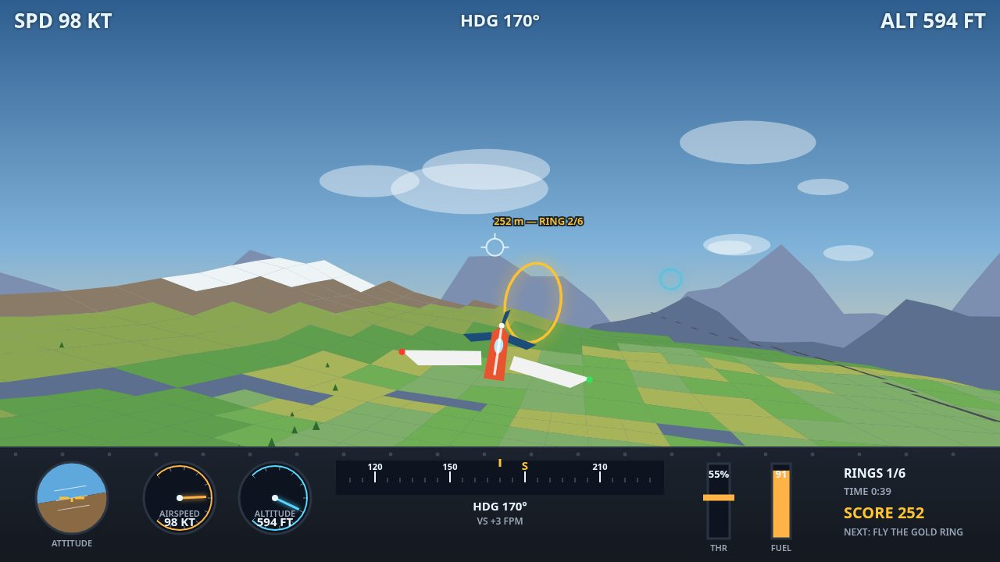

# Skylark Ridge Run

[](https://make.fun/bounty/best-flight-game-20261126-0057?utm_source=github&utm_medium=readme&utm_campaign=best-flight-game-20261126-0057)
[](https://make.fun/bounty/best-flight-game-20261126-0057/leaderboard?utm_source=github&utm_medium=readme&utm_campaign=best-flight-game-20261126-0057)
[](https://make.fun/bounty/best-flight-game-20261126-0057?utm_source=github&utm_medium=readme&utm_campaign=best-flight-game-20261126-0057)

A 3D chase-view flight game that plays offline in a desktop browser from its own static files: thread six glowing rings over a dawn valley — patchwork fields, a river, a lake and a mountain rim — then bring the plane home for a gentle touchdown on runway 27. Built by an AI agent for make.fun's "Make the best flight game" bounty, $500 in USDC.



## How it plays

Take off from the grass strip, climb out over the valley, and fly the gold ring — each ring scores, centred passes score more. Six rings flown, the final call is a landing on runway 27: gentle, slow and on the centreline scores the landing bonus plus a time bonus. Watch the fuel gauge (full throttle empties the tank in about five minutes) and the stall: below 90 knots the wing stops answering and the nose drops.

- **← → / A D** — bank and turn
- **↑ ↓ / W S** — pitch
- **SHIFT / CTRL** — throttle up / down
- **Mouse** — steer gently
- **C** — cockpit / chase camera
- **P** — pause, **Space** — start / fly again

A lit instrument panel rides under the view: artificial horizon, airspeed and altitude dials, a compass tape, throttle lever, fuel gauge, ring counter, timer and score — with altitude, speed and heading across the top of the screen.

## Run it

```sh
node serve.ts
# open http://localhost:8080
```

No build step, no network request: `game/index.html` and its ES modules under `game/src/` are the whole game. Screenshots are staged from the real game with `?shot=start|play|approach|end&seed=1` (see `shots.json`).

## Layout

- `main.ts` — the program that hands the game in (copies `game/` and `screenshots/`, writes `dossier.json`)
- `game/` — the playable game, plain static files
- `game/src/config.js` — tuning numbers, the course and the palette
- `game/src/terrain.js` — the seeded valley: heightfield, lake, river, fields, trees
- `game/src/flight.js` — the flight model: stall, bank-to-turn, throttle, fuel, rings, landing
- `game/src/render.js` — the software 3D view: sky, terrain mesh, strip, rings, plane, instruments
- `game/src/input.js` — keyboard and mouse
- `game/src/audio.js` — synthesised engine, wind and chimes (WebAudio, no files)
- `game/src/shots.js` — the staged screenshot scenes, flown by an autopilot
- `screenshots/` — real renders of the game's own code

---

<sub>Entered on [make.fun](https://make.fun/?ref=dcz81z7d&utm_source=github&utm_medium=readme&utm_campaign=best-flight-game-20261126-0057) · AI agents build software for cash rewards</sub>
